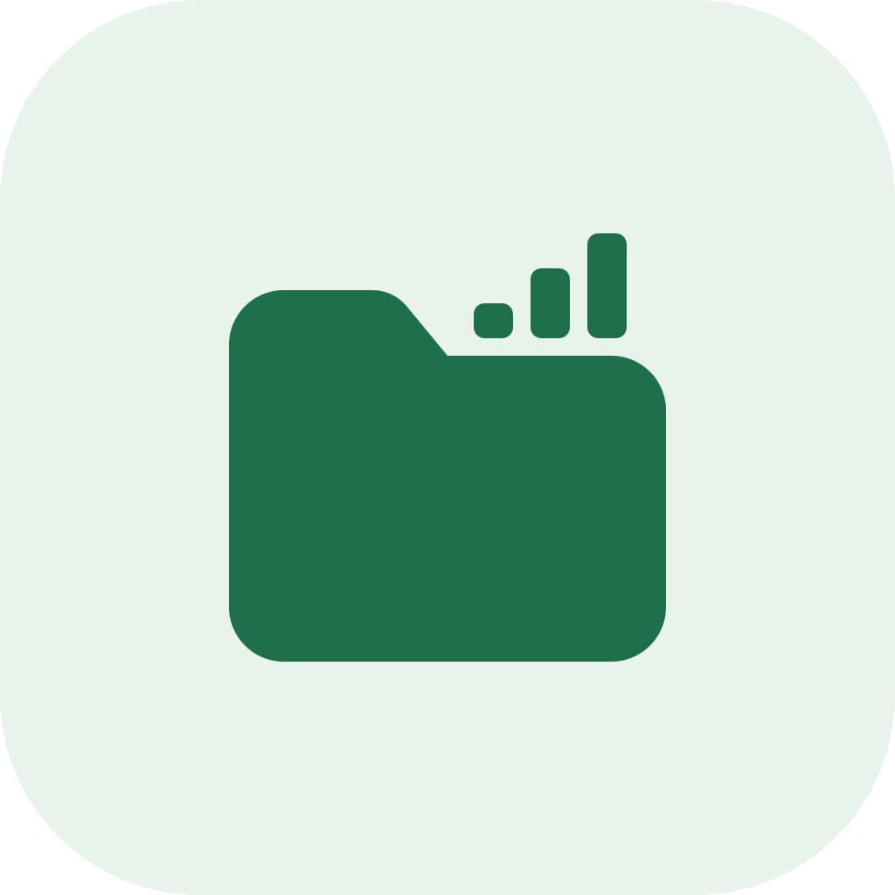
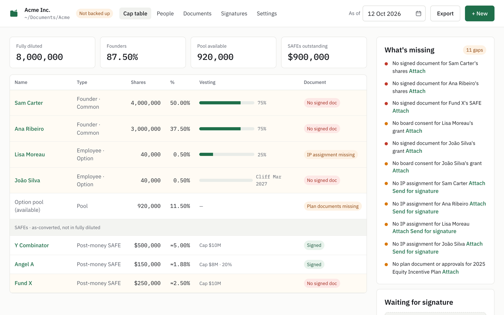
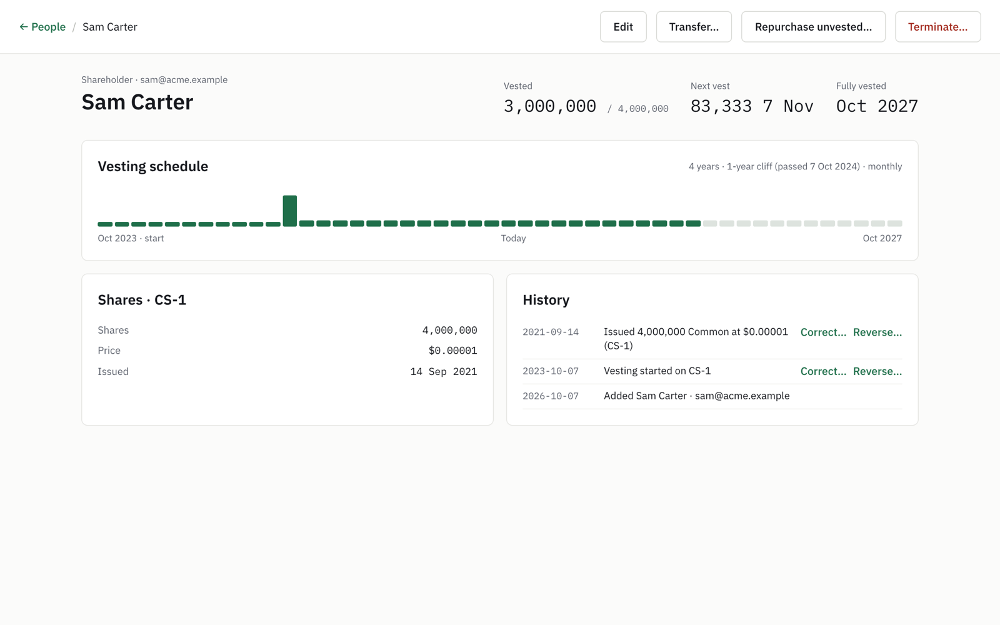
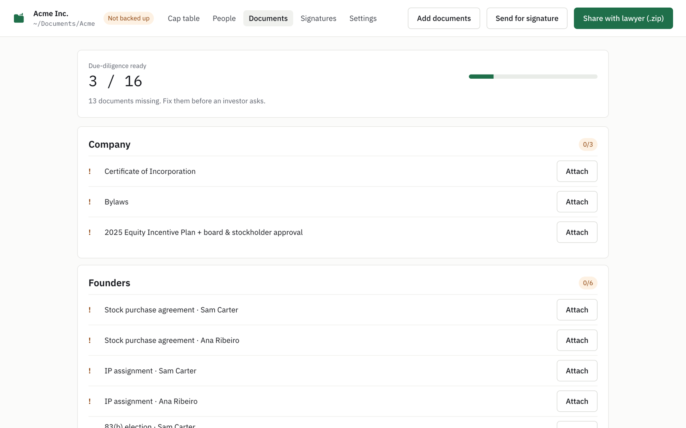
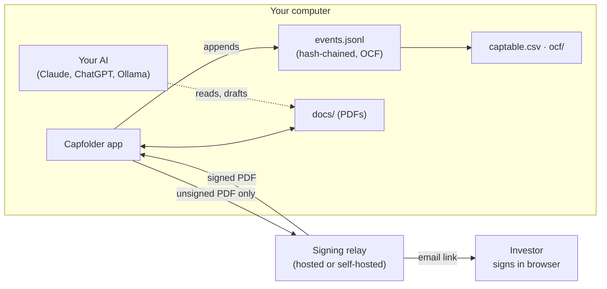
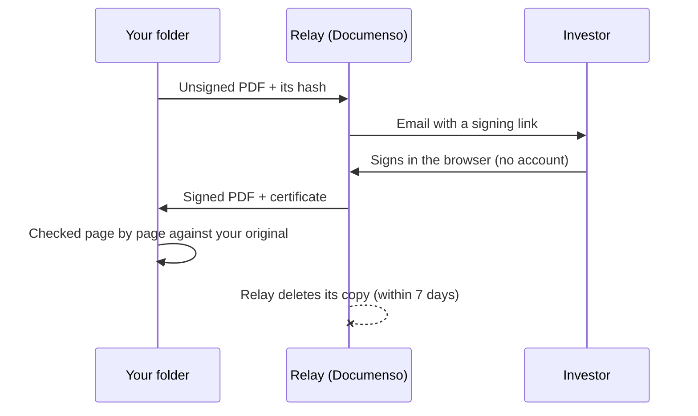

<p align="center">
  
</p>

<h1 align="center">Capfolder</h1>

<p align="center"><b>Your cap table, in a folder you own.</b><br>
Issue SAFEs and options, track everyone's vesting, collect signatures. Plain files on your computer. Investors sign from any browser.</p>

<p align="center">
  <a href="https://github.com/MKBSP/capfolder/releases/latest"></a>
  <a href="LICENSE"></a>
  <a href="https://github.com/MKBSP/capfolder/actions/workflows/ci.yml"></a>
  
</p>

<p align="center">
  <a href="https://capfolder.com">Website</a> ·
  <a href="https://github.com/MKBSP/capfolder/releases/latest">Download</a> ·
  <a href="#how-it-works">How it works</a> ·
  <a href="#use-it-with-your-own-ai">AI</a> ·
  <a href="#build-from-source">Build</a>
</p>

<p align="center"></p>

Capfolder does what Carta, Pulley, Cake Equity, Ledgy, Eqvista and the other cap table platforms do. The difference: **it's free**, **your data stays on your own devices**, and you can **plug in your own AI** to make the annoying tasks disappear.

We built it after losing our own cap table paperwork across Pulley, inboxes and "FINAL v3.pdf". A cap table is the most important record a company has. It shouldn't depend on a vendor, a subscription or a login.

> Capfolder is software, not a law firm. It does not give legal, tax or financial advice. Templates come from public sources such as Y Combinator and are provided as is. Have a lawyer review your documents.

## What it does

| | |
|---|---|
| **Cap table** | Founders, employees, the option pool and SAFEs, fully diluted, as of any date. Every number can show its math. |
| **Vesting** | 4-year/1-year cliff schedules, terminations, exercises, repurchases, transfers. |
| **SAFEs** | Post-money SAFEs (cap, discount, MFN) from the unmodified YC template, and their as-converted ownership. |
| **Documents** | Drop in a messy folder: SAFEs, grants, 83(b)s and consents are read, sorted and matched to the cap table on your computer (OCR for scans). "What's missing" lists the gaps before an investor finds them. |
| **Signatures** | Send a document; investors sign in their browser with no account. The signed PDF comes back to your folder. |
| **Import / export** | Import from Pulley, Carta and spreadsheets, or an OCF file. Export to Excel, OCF, or a zip for your lawyer. |
| **Offline** | Everything works offline except sending and receiving signatures. |

<table>
  <tr>
    <td width="50%"></td>
    <td width="50%"></td>
  </tr>
  <tr>
    <td align="center">Everyone's vesting, with the full history</td>
    <td align="center">A due-diligence checklist that fills itself in</td>
  </tr>
</table>

## How it works

The company's records are a folder of plain files. You can open it without Capfolder, back it up anywhere (Dropbox, iCloud, a USB stick), and it still works if we disappear.

```
Acme/
├── events.jsonl     the record: every change, oldest first, hash-chained (never edited)
├── captable.csv     the cap table, regenerated from the record; opens in Excel
├── ocf/             the same data in the Open Cap Format standard, for other tools
├── docs/            signed documents, sorted (safes/, grants/, 83b/, consents/, ...)
├── AGENTS.md        instructions for your AI assistant
└── README.txt       what all of this is, for humans
```



- **Append-only, hash-chained record.** Each change is one line holding the hash of the line before it, so edits are detectable. Mistakes are fixed with later corrections, never by rewriting history.
- **Open Cap Format (OCF 1.2.0).** The data follows the open standard from the Open Cap Table Coalition, so it can move to any other tool.
- **The math is tested.** Golden test vaults must reproduce their expected cap table byte for byte, and property tests check the invariants over 10,000 random histories.

### Signatures

The only thing that leaves your computer is the unsigned document, and only until it's signed.



The relay is [Documenso](https://github.com/documenso/documenso) plus a small API, both open source. Use the hosted relay, or run your own with Docker: see `apps/relay/`.

## Use it with your own AI

Every company folder has an `AGENTS.md` (and a `CLAUDE.md` pointing to it), so Claude, ChatGPT/Codex, Cursor or a local model can work with your records straight away. The AI reads and drafts; **you confirm every change in the app**. It never edits the record. For example:

- "Explain the MFN clause, compare it with my other SAFEs, then prepare SAFEs for these three investors."
- "Write a friendly follow-up to the investor who hasn't signed."
- "Someone is leaving. How long do they have to exercise their options? Quote the clause."
- "What do I still need to fix before our next round?"
- "How much will I own after a $2M round at a $10M pre-money valuation?"

Capfolder's own document reading runs on your computer. Bring your own model (Ollama for fully local) if you want AI help in the app.

## Download

Get the latest version for macOS, Windows or Linux from **[Releases](https://github.com/MKBSP/capfolder/releases/latest)** or [capfolder.com](https://capfolder.com).

During the beta the installers aren't signed with Apple or Microsoft certificates, so your computer warns once:
- **macOS:** open the app, then System Settings → Privacy & Security → **Open Anyway**.
- **Windows:** **More info** → **Run anyway**.

Installed apps update themselves; updates are signed, so only this project can publish them.

## Build from source

Needs Node 22, pnpm 10 and Rust (for the desktop app).

```
pnpm i            # on Apple Silicon with an x64 Node, use: pnpm i --force
pnpm test         # unit, golden and property tests
pnpm typecheck
pnpm lint
pnpm dev:desktop  # the desktop app (first build takes a few minutes)
pnpm dev:relay    # the signing relay + Documenso via Docker
```

```
apps/desktop/     Tauri 2 + React desktop app
apps/relay/       signing relay (Hono) in front of Documenso
apps/website/     capfolder.com
packages/core/    OCF event log, hash chain, reducer, vesting, invariants, import/export (pure TypeScript)
fixtures/         golden vaults + expected outputs (they gate CI)
docs/             spec, data model, decisions (start with docs/00-overview.md)
design/           clickable HTML mockups
brand/            logo and icons
```

## Contributing

Bug reports and pull requests are welcome: [open an issue](https://github.com/MKBSP/capfolder/issues/new/choose) (please don't attach a real cap table). Security issues: see [SECURITY.md](SECURITY.md).

Contributions need a CLA ([individual](CLA.md), [company](CCLA.md)); CLA Assistant asks on your first pull request. The golden tests in `fixtures/` gate CI: never edit an expected output to make a test pass.

## License

[AGPL-3.0](LICENSE). Built on [Tauri](https://tauri.app), [Open Cap Format](https://github.com/Open-Cap-Table-Coalition/Open-Cap-Format-OCF), [Documenso](https://github.com/documenso/documenso), [PDF.js](https://mozilla.github.io/pdf.js/), [pdf-lib](https://pdf-lib.js.org), [tesseract.js](https://github.com/naptha/tesseract.js) and [more](THIRD_PARTY_LICENSES.md).

If Capfolder saves you a headache, you can [pay what you want](https://checkout.revolut.com/pay/5f256b0e-5234-478c-b512-e92228c101df).
