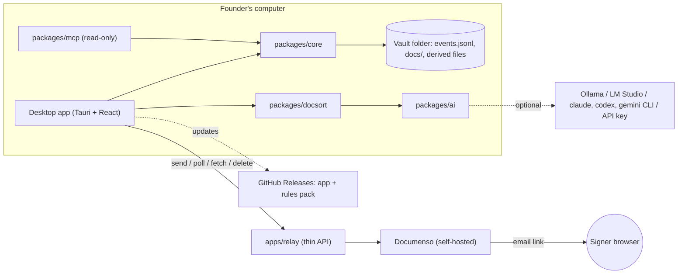

# 01 · Architecture

## Picture


## Monorepo (pnpm workspaces), as built (2026-11-06)
```
apps/
  desktop/        Tauri 2 app. React + TypeScript + Vite UI, Rust in src-tauri/. Ask AI in src/chat.ts (docs/18)
  website/        Static site (landing, features, help, guides); vite dev, plain HTML pages
  relay/          Thin Hono API in front of Documenso + docker-compose
packages/
  core/           OCF types, event log, hash chain, reducer → cap table, vesting, invariants, import/export,
                  and scenario/ (what-if math: founders, pool, SAFEs, priced rounds, exit; never writes)
  vault/          The company folder: Fs interface (Node, memory, Tauri), create/open/append, registry, lock
  capfolder/      The npm package "capfolder": MCP server (tools/read.ts, tools/write.ts), install for
                  Claude/Codex/Gemini, and tools/plans.ts, the tools defined once for MCP and Ask AI
skills/           The Claude skill (copied into plugin/ and GEMINI.md; packaging.test.ts keeps them identical)
fixtures/         Golden vault (acme-vault) + expected outputs
```
The original plan's `importers`, `docsort`, `ai`, `mcp`, `rules` and `ui` packages were folded into `core`, `desktop` and `capfolder` as they were built.

### Scenarios and the shared AI tools (decided 2026-11-06, F-39)
- **One engine, three fronts.** What-if math lives in `packages/core/src/scenario/` and is pure: `runScenario(start, steps, sweep?)`. The desktop screen, the MCP tool, Ask AI and the website calculator all call it; none of them adds up shares.
- **Recordable vs projection.** Founders, pool, SAFE and grant steps run through the real builders and `appendEvents` on an in-memory copy of the log, so every app check applies; a priced round and an exit are math over holdings and never become events (docs/03 decision). A real priced round is recorded by the app when it closes (CAP-49 item 6).
- **Tools defined once.** `packages/capfolder/src/tools/plans.ts` holds a tool's pure parts (zod input, description, the function that renders the result, and the JSON Schema for chat providers). `tools/read.ts`/`write.ts` keep the MCP registration and Node I/O; `apps/desktop/src/chat.ts` imports the same file. `run_scenario` is the first tool built this way; moving the existing `propose_*` tools over is the follow-up ticket.
- **Benchmarks are data with sources.** `scenario/benchmarks.ts` carries every default (Carta, year, URL); results show the source and never say "should".

## Stack and libraries (prefer these; all AGPL-compatible) [verify licenses on add]
| Need | Library |
|---|---|
| Desktop shell | Tauri 2, plugins: `updater`, `fs`, `dialog`, `shell` (scoped, to spawn AI CLIs), `notification` |
| OS keychain / app lock | Rust `keyring` crate. Biometric on macOS via LocalAuthentication, Windows Hello via WinRT [verify which Tauri plugin or crate covers desktop biometrics] |
| UI | React + TypeScript. Plain CSS variables from `docs/08` (no heavy UI kit needed) |
| OCF | OCF JSON Schemas (Open Cap Table Coalition) + `ocf-types` package; `ajv` for validation |
| Spreadsheets | `exceljs` (MIT) for read/write xlsx; `papaparse` for CSV |
| PDF | `pdfjs-dist` (read/render), `pdf-lib` (fill templates) |
| OCR | `tesseract.js` (runs locally in the webview) |
| Hashing | WebCrypto SHA-256; canonical JSON (RFC 8785 JCS) |
| MCP | `@modelcontextprotocol/sdk` (TypeScript) |
| Signing | Documenso (self-hosted Docker image) + its v2 API [verify which features need the enterprise license] |
| Vesting reference | Captable, Inc. (AGPL) for logic to port [verify maintenance status] |

## Process model
- The **React UI** calls **core** directly. It's pure TypeScript, no I/O.
- File I/O goes through Tauri commands: read/append `events.jsonl`, copy into `docs/`, watch the folder for outside changes (F-31, F-35).
- **The reducer is pure:** `events → state`. All views are derived. The "as of" date is just replaying to that date.
- v1 has **no SQLite**. Vaults are small (hundreds of events), so state is rebuilt in memory on open. Add an index later only if profiling says so.
- **App settings** (lock method, AI provider, relay URL, update channel) live in the OS app-data dir, **not in the vault**. The vault holds company data only.

## The relay (the only server)
- A thin API that:
  - verifies the founder's email (6-digit code);
  - holds the Documenso admin token;
  - proxies create/send/status/download/delete;
  - enforces quotas;
  - auto-deletes envelopes older than 30 days.
- The desktop app never holds a Documenso admin token.
- Self-hosters run `apps/relay` + Documenso via one `docker compose up`.
- Details are in `docs/05-signing.md`.

## Security notes
- The vault is plain files by design. Say so in the UI (F-03).
- Rules packs and app updates are signed. Reject anything unsigned.
- AI CLIs run through the scoped shell plugin, with allow-listed binaries only (`claude`, `codex`, `gemini`).
- Treat all document text as untrusted input to the AI, because it may contain prompt injection. Extraction returns schema-validated JSON only, and the founder confirms it.
- The MCP server is read-only by default and binds to stdio (no network port).
