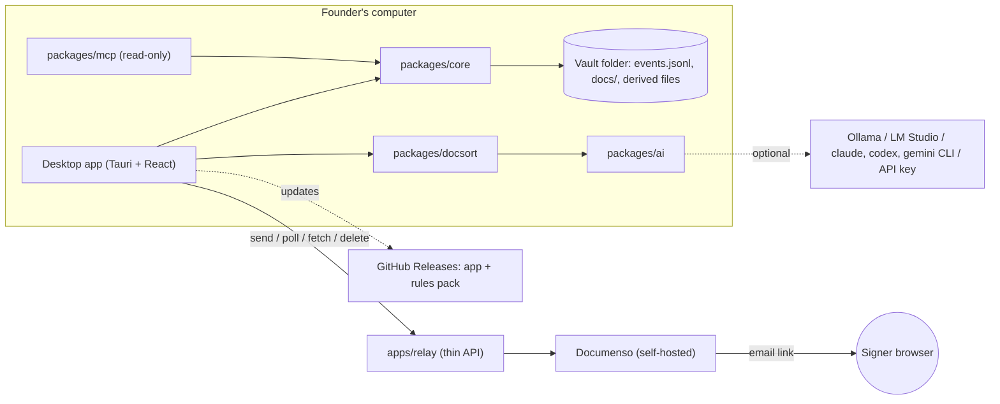

# 01 · Architecture

## Picture


## Monorepo (pnpm workspaces)
```
apps/
  desktop/        Tauri 2 app. React + TypeScript + Vite UI, Rust in src-tauri/
  website/        Static landing page (start from design/website/index.html)
  relay/          Thin TypeScript API in front of Documenso (Hono or Fastify) + docker-compose
packages/
  core/           OCF types, event log, hash chain, reducer → cap table, vesting, invariants, exports
  importers/      Format detection + mappers: OCF, OCX, Pulley, Carta, Cake, generic
  docsort/        PDF text, OCR, classify, extract, match, file
  ai/             Provider interface + providers (ollama, lmstudio, claude-cli, codex-cli, gemini-cli, anthropic, openai)
  mcp/            MCP server exposing read-only vault tools
  rules/          Rules pack schema, loader, signature check, default pack
  ui/             Shared React components + design tokens (docs/08)
fixtures/         Golden vaults + expected outputs
```

## Stack and libraries (prefer these; all AGPL-compatible) [verify licenses on add]
| Need | Library |
|---|---|
| Desktop shell | Tauri 2, plugins: `updater`, `fs`, `dialog`, `shell` (scoped, to spawn AI CLIs), `notification` |
| OS keychain / app lock | Rust `keyring` crate. Biometric on macOS via LocalAuthentication, Windows Hello via WinRT [verify which Tauri plugin or crate covers desktop biometrics] |
| UI | React + TypeScript. Plain CSS variables from `docs/08` (no heavy UI kit needed) |
| OCF | OCF JSON Schemas (Open Cap Table Coalition) + `ocf-types` package; `ajv` for validation |
| Spreadsheets | `exceljs` (MIT) for read/write xlsx; `papaparse` for CSV |
| PDF | `pdfjs-dist` (read/render), `pdf-lib` (fill templates) |
| OCR | `tesseract.js` (runs locally in the webview) |
| Hashing | WebCrypto SHA-256; canonical JSON (RFC 8785 JCS) |
| MCP | `@modelcontextprotocol/sdk` (TypeScript) |
| Signing | Documenso (self-hosted Docker image) + its v2 API [verify which features need the enterprise license] |
| Vesting reference | Captable, Inc. (AGPL) for logic to port [verify maintenance status] |

## Process model
- The **React UI** calls **core** directly. It's pure TypeScript, no I/O.
- File I/O goes through Tauri commands: read/append `events.jsonl`, copy into `docs/`, watch the folder for outside changes (F-31, F-35).
- **The reducer is pure:** `events → state`. All views are derived. The "as of" date is just replaying to that date.
- v1 has **no SQLite**. Vaults are small (hundreds of events), so state is rebuilt in memory on open. Add an index later only if profiling says so.
- **App settings** (lock method, AI provider, relay URL, update channel) live in the OS app-data dir, **not in the vault**. The vault holds company data only.

## The relay (the only server)
- A thin API that:
  - verifies the founder's email (6-digit code);
  - holds the Documenso admin token;
  - proxies create/send/status/download/delete;
  - enforces quotas;
  - auto-deletes envelopes older than 30 days.
- The desktop app never holds a Documenso admin token.
- Self-hosters run `apps/relay` + Documenso via one `docker compose up`.
- Details are in `docs/05-signing.md`.

## Security notes
- The vault is plain files by design. Say so in the UI (F-03).
- Rules packs and app updates are signed. Reject anything unsigned.
- AI CLIs run through the scoped shell plugin, with allow-listed binaries only (`claude`, `codex`, `gemini`).
- Treat all document text as untrusted input to the AI, because it may contain prompt injection. Extraction returns schema-validated JSON only, and the founder confirms it.
- The MCP server is read-only by default and binds to stdio (no network port).
