# Capfolder — Founder user stories & flows (v1)

One user: **the founder**, the only admin. Investors, employees and lawyers appear only as people who sign or receive files.

Each story has the happy path, what can go wrong (and why), what the app does, and a flowchart.

---

## Rules every flow follows

1. **The folder is the source of truth.** `events.jsonl` is the record. `captable.csv` and the SQLite index are rebuilt from it.
2. **Nothing is deleted from the record.** A mistake is fixed with a correction event. A removed document moves to `docs/_removed/`. The app never empties it.
3. **Drafts are free, issued things are events.** A grant or SAFE can be edited until it's sent. After that, changes are new events.
4. **Ownership changes need paper.** Any event that moves equity links to a signed document, or shows up in "What's missing".
5. **Checks run after every event.**
   - Issued shares can't exceed authorized shares.
   - Vested can't exceed granted.
   - Percentages sum to 100.00%.
   - The pool can't go negative.
   - A failed check blocks the save and says why.
6. **AI proposes, the founder confirms.** Nothing an AI extracts is saved without a click.
7. **Everything works offline** except sending for signature and pulling signed documents back.
8. **App lock is not encryption.** Files stay plain and readable. Encryption is a later, opt-in feature.

---

## Built on open source (so we don't reinvent the hard parts)

| Hard part | What we use | Why |
|---|---|---|
| Data model and edge cases (transfers, cancellations, return to pool, vesting, SAFE conversion) | **Open Cap Table Format (OCF)**, the open JSON standard from the Open Cap Table Coalition | Lawyers and cap-table vendors already defined these rules. Our `events.jsonl` is a list of OCF transactions, so we can import and export OCF |
| Reading and writing OCF | OCF JSON schemas + `ocf-types` (TypeScript), `pyocf` (Python, MIT) | Validation for free |
| Vesting and cap-table math | Port from Captable, Inc. (AGPL, same license as ours) [check it's still maintained], plus our own golden tests | OCF describes the data but does no math, so the math is the part we own and test hardest |
| Signing | **Documenso**, self-hosted by us or the user (AGPL) | Signing UI, emails, audit log and sealed PDF are already built |
| PDFs | PDF.js (read), pdf-lib (fill templates) | |
| Scans | Tesseract (local OCR) | |
| Local AI | Ollama / LM Studio, or the user's Claude Code / Codex CLI | |
| Desktop app + updates | Tauri + its updater plugin (signed updates from GitHub Releases) | |
| SAFE templates | YC's published post-money SAFEs, used unmodified and credited | |

**Rule:** if an open project or standard already defines a behaviour, we follow it rather than invent our own.

## Disclaimer (shown on first run, in every export, and in the website footer)

> Capfolder is software, not a law firm. It does not give legal, tax or financial advice. Templates come from public sources such as Y Combinator and are provided as is. Have a lawyer review your documents.

---

## Map

| # | Story | Group |
|---|---|---|
| F-01 | Download from the website | Get started |
| F-02 | Open the app the first time | Get started |
| F-03 | Turn on app lock | Get started |
| F-04 | Add email (optional) | Get started |
| F-05 | Create the company | Get started |
| F-06 | Choose: import or start from zero | Get started |
| F-07 | Import from Pulley / Carta | Get started |
| F-08 | Start from zero | Get started |
| F-09 | Drop in existing documents | Get started |
| F-10 | Connect an AI (optional) | Get started |
| F-11 | Issue a SAFE from our template | Issue & sign |
| F-12 | Record a SAFE signed elsewhere | Issue & sign |
| F-13 | Create the option pool and plan | Issue & sign |
| F-14 | Grant options | Issue & sign |
| F-15 | Issue shares | Issue & sign |
| F-16 | A signer doesn't sign | Issue & sign |
| F-17 | Cancel a document before it's signed | Issue & sign |
| F-18 | Fix a mistake | Changes |
| F-19 | Change a person's name or email | Changes |
| F-20 | An investor wants the SAFE moved to another entity | Changes |
| F-21 | Merge duplicate people | Changes |
| F-22 | An employee leaves | Changes |
| F-23 | An employee exercises options | Changes |
| F-24 | A founder leaves (repurchase unvested) | Changes |
| F-25 | Increase the option pool | Changes |
| F-26 | Add a document | Documents |
| F-27 | Delete a document | Documents |
| F-28 | Replace or rename a document | Documents |
| F-29 | Export Excel / CSV for a date | Share |
| F-30 | Send everything to a lawyer | Share |
| F-31 | Verify the vault / a file was edited outside the app | Safety |
| F-32 | Move to a new laptop | Safety |
| F-33 | Laptop lost or broken | Safety |
| F-34 | Touch ID fails / forgot the app password | Safety |
| F-35 | Two copies of the folder disagree | Safety |
| F-36 | The relay is down or I'm offline | Safety |
| F-37 | Switch to a self-hosted relay | Safety |
| F-38 | Update the app | Safety |

---

# A. Get started

## F-01 Download from the website

**As a** founder, **I want** to download the app quickly, **so that** I can try it on my real cap table.

**Steps**
1. The founder clicks **Download** on the website.
2. A Tally form asks for email (required) and computer (macOS / Windows / Linux). UTM and `ref` are captured as hidden fields.
3. They submit. The thank-you page shows the download link for each OS.
4. Under the links: "Capfolder is free. If it saves you a headache, pay what you want", linking to the Revolut checkout.
5. The download starts. The installer is ~10 MB and signed.

**What can happen**

| Situation | Why | What happens |
|---|---|---|
| Invalid email | Typo | Tally blocks the submit |
| Leaves at the email step | Doesn't want to share it | Lost download. Track the submit rate. If it's under ~60%, make email optional |
| Wrong OS picked | Clicked fast | All three links are on the thank-you page |
| Browser warns about the file | Unsigned build | Never ship unsigned. Notarize on macOS, sign on Windows |
| Pays via Revolut | Wants to support | Nothing changes in the app. A thank-you email can come later |

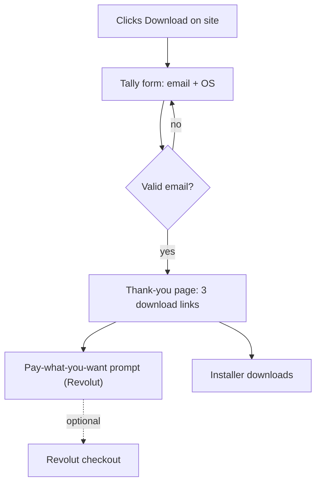

**Done when:** the email is in Tally and the founder has the installer.

---

## F-02 Open the app the first time

**Steps**
1. Install: drag to Applications on macOS, run the installer on Windows, AppImage or .deb on Linux.
2. Open it. The welcome screen says "Your cap table will live in a folder on this computer. No account needed." It also has a toggle, on by default: "Send anonymous usage counts (no company data)", linking to exactly what is sent (docs/11).
3. The app continues to app lock (F-03).

**What can happen**

| Situation | Why | What happens |
|---|---|---|
| macOS says "can't be opened" | Not notarized, or quarantine | Must not happen. Notarization is in CI |
| Opened before, has a vault | Reinstall | The app finds recent vaults and offers "Open Acme" |
| Has a folder from another computer | New laptop | "Open existing folder" goes to F-32 |

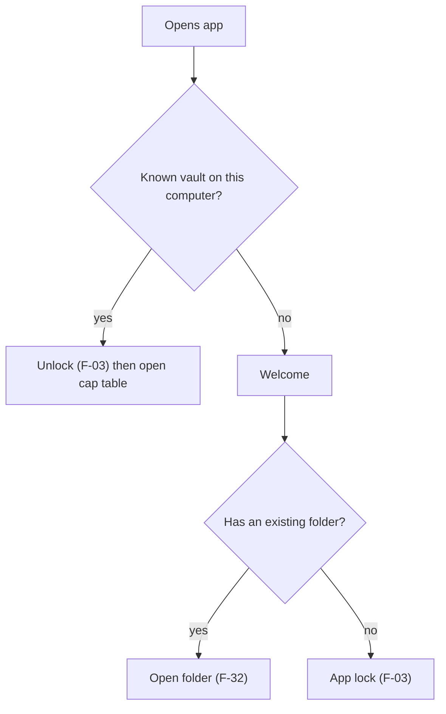

---

## F-03 Turn on app lock

**As a** founder, **I want** the app to ask for Touch ID or a password when it opens, **so that** someone at my desk can't see the cap table.

**Steps**
1. The founder chooses **Touch ID / system password** (macOS), **Windows Hello** (Windows), or an **app password** (Linux, or anyone who prefers one). The app password is stored as a hash in the OS keychain.
2. They choose when it locks: on quit, or after 5 / 15 / 60 minutes idle.
3. The app says plainly: "This locks the app, not the files. Anyone with access to your computer account can still open the folder."

**What can happen**

| Situation | Why | What happens |
|---|---|---|
| Skips the lock | Doesn't care | Allowed. It can be turned on in Settings |
| Expects the files to be encrypted | Reasonable assumption | The copy above. Encryption is listed as "coming later" |
| No Touch ID hardware | Older Mac | Falls back to the system password |
| Forgets the app password | Human | See F-34. The data is never at risk because the files aren't encrypted |

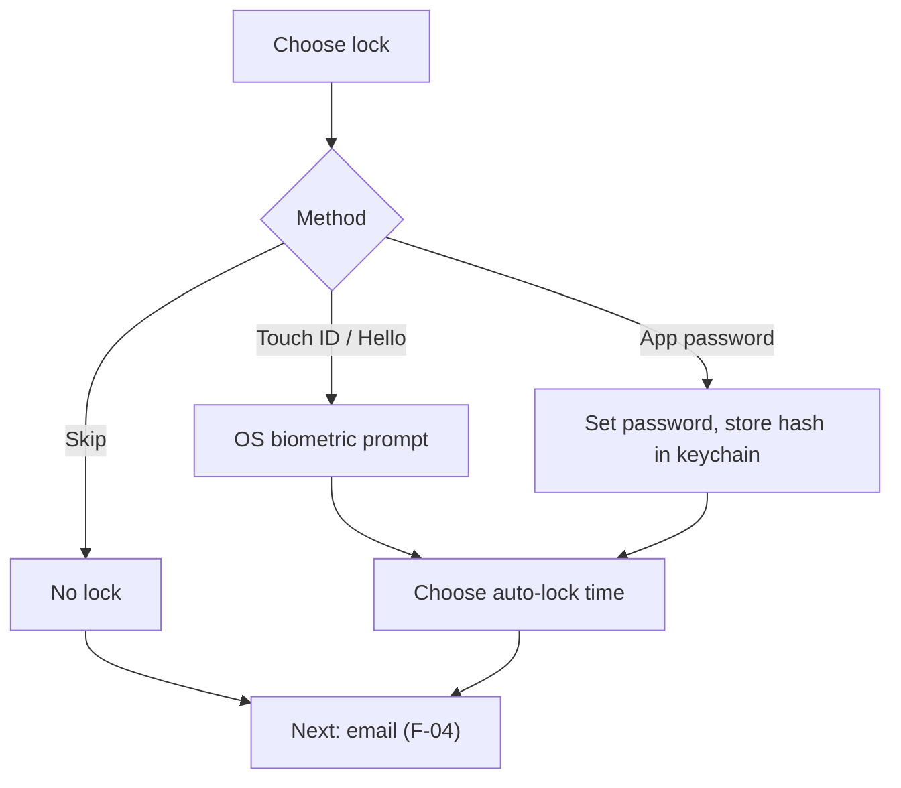

---

## F-04 Add email (optional)

**Why ask:** signing requests are sent "from" this email via the relay, and it's used for update notices. The app works fully without it.

**Steps**
1. Field: "Your email (optional): used only when you send something for signature."
2. If they fill it in, the relay sends a 6-digit code and they enter it. It's verified once.
3. If they skip, the app asks again at the first "Send for signature" (F-11).

**What can happen**

| Situation | Why | What happens |
|---|---|---|
| Skips | Privacy | Fine. Everything except signing works |
| Code never arrives | Spam filter, offline | "Resend", or "Do this later" |
| Different email from the website one | Work vs personal | Fine. They aren't linked. The app can't read the Tally form, so there's no prefill |

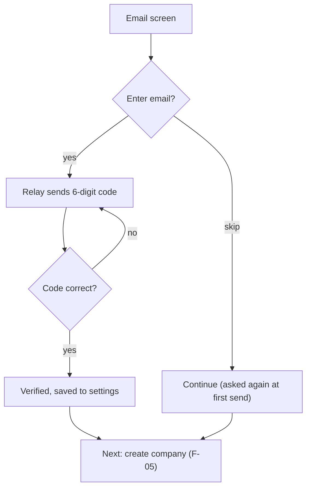

---

## F-05 Create the company

**Steps**
1. Company legal name, entity type (Delaware C-corp in v1, others shown as "coming soon"), date of incorporation.
2. Folder location. The default is `~/Documents/<Company>`.
3. Backup check: the app detects if the folder is inside iCloud Drive, Dropbox, Google Drive or a git repo.
   - If it isn't: "This folder isn't backed up. Move it somewhere that is?" offers known synced folders.
4. The app creates the folder with `README.txt`, `events.jsonl` (first event `company_created`), an empty `docs/` and `captable.csv`.

**What can happen**

| Situation | Why | What happens |
|---|---|---|
| Not a Delaware C-corp | PT Lda, DK ApS, UK Ltd | They can still track. A banner says templates and checks are US-only for now |
| Folder already exists with files | Picked a messy folder | The app creates `Capfolder/` inside it, or offers to sort the existing files (F-09) |
| No backup found | Local disk only | A yellow warning stays on the home screen until a backup exists |
| Two companies | Serial founder | Each company is its own folder. A switcher sits in the top left |

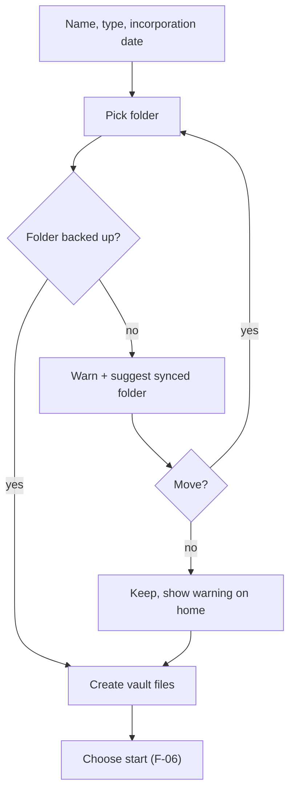

---

## F-06 Choose: import or start from zero

Three choices, one click each:

1. **Import from Pulley or Carta** (F-07): you have a cap table somewhere.
2. **Start from zero** (F-08): new company, or one with only a spreadsheet.
3. **I only have documents** (F-09): build the cap table from PDFs.

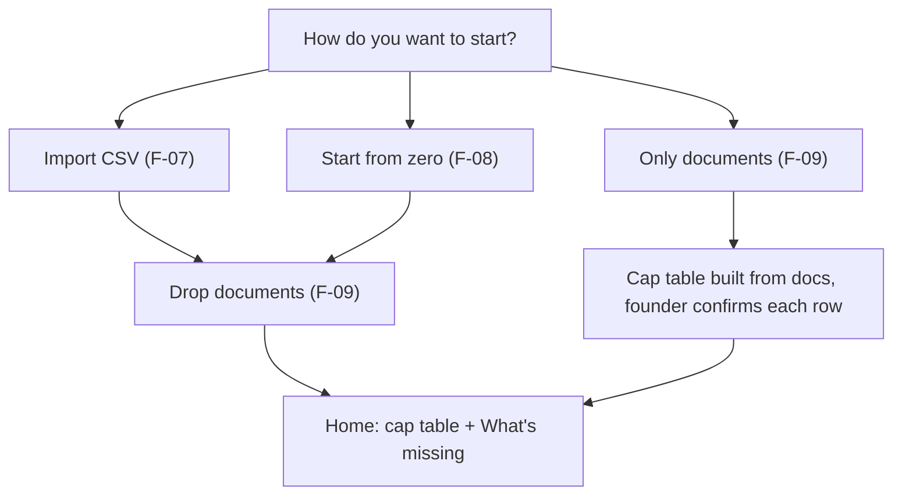

---

## F-07 Import from another cap table tool

**Context:** Pulley stops operating on **Dec 8, 2026**. The deadline to opt into Pulley's Carta migration is Nov 30, and limited data access is expected to end on Jan 31, 2027. Many founders must move their cap table now, so this is the most important flow in the app.

**As a** founder, **I want** my existing cap table in one step, **so that** I don't re-type 30 investors.

**What we accept, best first**

| Source | What the founder exports | Where |
|---|---|---|
| Any tool that exports **OCF** | OCF zip or folder | Best case: lossless, with full history |
| **Carta** | "Open Cap Table report" (OCX, the coalition's Excel standard), plus the Cap table report (Summary, Detailed, Securities ledger), Vesting report and Stakeholder details | Cap Table → Run reports |
| **Pulley** (until Dec 8) | Detailed Cap Table (Excel), plus every signed document | Dashboard → Download Cap Table, or Company → Reports → Detailed Cap Table |
| **Cake Equity** | Cap table (XLSX), Contact details (CSV), Noteholders (CSV, SAFEs), Equity grants (vesting), Transaction history | Compliance → Reporting → Exports |
| **Any spreadsheet** | Whatever they have | AI-assisted column mapping |

**Steps**
- **a. Pick the source tool.** The app shows that tool's export steps, with screenshots, kept in the rules pack so we can update them without shipping a new app (F-38).
- **b. Drop the file(s).** The app detects the format by its headers and sheet names: OCF, OCX, Pulley, Carta, Cake, or unknown.
- **c. Map.**
  - Known formats map automatically.
  - Unknown columns: AI suggests a mapping, the founder confirms, and the mapping is saved for next time.
- **d. Build OCF objects.** Stakeholders, stock classes, plans, vesting terms and transactions. If the export only has a snapshot and no history, the app creates one dated `issuance` per position and marks them "imported snapshot".
- **e. Validate** against the OCF schemas. Errors are listed per row.
- **f. Reconcile.**
  - Total shares, fully diluted, % per class and stakeholder count are compared with the export's own summary sheet.
  - If they don't match: the rows that differ are shown and saving is blocked until fixed or explicitly accepted.
- **g. Save.** Events are written with `source: <file>` and the original files are kept in `docs/_imports/`.
- **h. Drop documents (F-09).** Reports never include signed documents, so they must be dropped in separately.

**What can happen**

| Situation | Why | What happens |
|---|---|---|
| Only a snapshot, no history | Report exports | Imported as dated positions. History starts here. Shown in What's missing |
| Vesting missing or only "vested so far" | Partial reports | Asks for the vesting report, or flags "vesting unknown" per grant |
| SAFEs in a separate file | Cake "Noteholders", Carta ledgers | "No SAFEs found. Drop your SAFE export too?" |
| Totals don't match | Rounding, cancelled grants, bad export | Diff view: fix the mapping, edit the row, or accept with a note |
| Same person spelled twice | History | Suggests a merge (F-21) |
| Pulley already closed | Missed the deadline | Use F-09 (documents only), plus any old Excel |
| New format we haven't seen | Vendor changed the export | AI mapping + reconcile. The founder can share an anonymized sample so we add a rule |

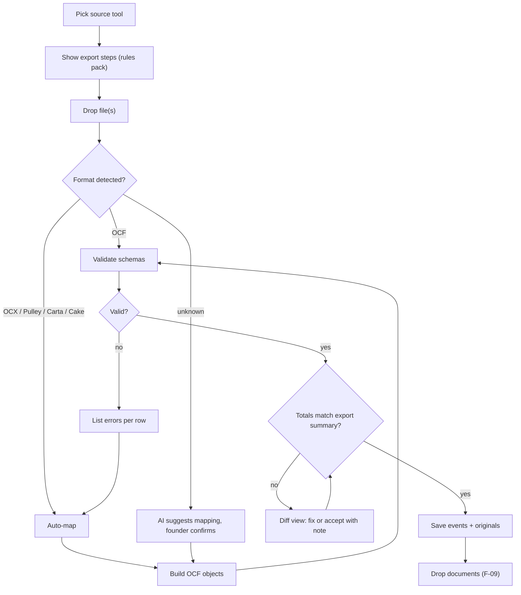

**Done when:** totals match to the share, the file passes OCF validation, and every row is saved with its source.

**Test data needed (urgent):** real exports from the pilot company's Pulley account before Dec 8. That means the Detailed Cap Table Excel, every report Pulley offers, and every signed PDF. They're the test fixtures for this flow.

---

## F-08 Start from zero

**Steps**
- **x. Shares.** Authorized shares and par value, e.g. 10,000,000 at $0.00001.
- **y. Founders.** Name, email, shares, and an optional vesting schedule (4-year, 1-year cliff, monthly is the default).
  - The app offers to generate a stock purchase agreement and IP assignment, or to attach the existing ones.
  - If the founder issue date is in the last 30 days: "File your 83(b) within 30 days of [date]" with the deadline shown.
- **z. Optional extras.** Add an option pool (F-13) and add SAFEs already signed (F-12).
- **Save.** The cap table appears.

**How it looks:** a guided form, one short question per screen, like Typeform rather than a settings panel. The live cap table builds on the right as they answer.
- Common answers are buttons: "4 years · 1-year cliff · monthly" is preselected, with "Custom" next to it.
- Numbers show their effect while typing: "4,000,000 shares = 40% of authorized".
- Every answer can be changed later through the normal **+ New** and **Edit** screens. There is no settings toolbox.

**What can happen**

| Situation | Why | What happens |
|---|---|---|
| Founder shares exceed authorized | Typo | Blocked: "Issued would exceed authorized (12,000,000 > 10,000,000)" |
| No vesting on founders | Common at day one | Allowed. A note says investors usually ask for it |
| 83(b) deadline already passed | Late | Shown as a warning, not a block. "Talk to your lawyer" |
| Founders split doesn't add up | Expecting % but typed shares | A live % column shows while typing |

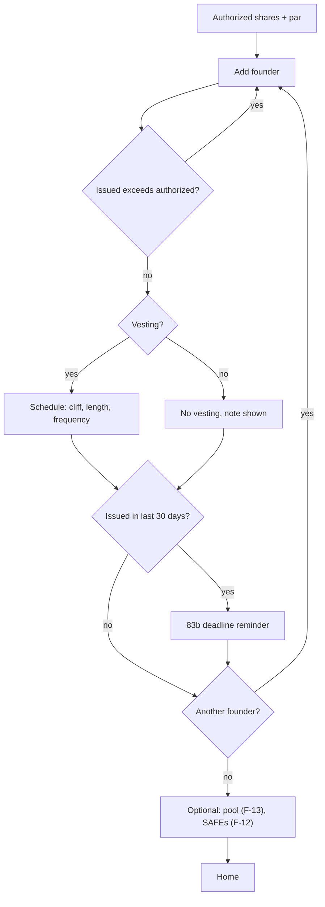

---

## F-09 Drop in existing documents

**How it works:** the same pattern as the expense organiser. Rules come first, then similar past documents, then AI for whatever is still unclear. The founder reviews only the exceptions.

**Steps**
1. Drag a folder or PDFs/images in.
2. For each file:
   - **Read:** use the text layer, or local OCR (Tesseract) for scans and photos.
   - **Type:** rules match known templates (YC SAFE, standard grant notices, 83(b) wording, board consents).
     - If no rule matches, compare to documents the founder already confirmed (nearest match).
     - If that's still unclear, AI decides (F-10). Without AI it goes to "Needs you".
   - **Fields:** fill a fixed schema (parties, amount, cap, discount, date, shares, strike, signatures present, page of each field).
   - **Match:** link to a cap-table row by amount + date first, then name and email.
   - **Check:** if the fields contradict the cap table (amount differs), it goes to "Needs you" and is never auto-filed.
   - **File:** copy to `docs/<type>/<date>_<person>.pdf`. The original name is kept in metadata and the original file is untouched.
3. Review "Needs you" one at a time: confirm, fix a field, or "Not an equity document".
4. Confirming creates a rule (e.g. "Fund X Ventures I, L.P." = Fund X), so next time it's automatic.

**What can happen**

| Situation | Why | What happens |
|---|---|---|
| Scan is unreadable | Bad photo | The field is marked "unreadable". The founder types it or uses the imported value |
| Doc matches no row | A SAFE not in the import | Offers "Add to cap table" (F-12) |
| Duplicate file | Same PDF twice | Same hash, skipped silently. Shown in the summary |
| Unsigned version | Draft PDF | "No signatures found". Filed as draft, and the row stays in What's missing |
| Not equity (receipt, photo) | Messy folder | Skipped, not copied |
| No AI connected | Founder's choice | Rules and matching still work. More files land in "Needs you" |

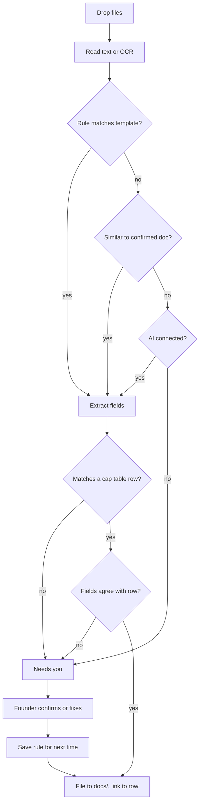

---

## F-10 Connect an AI (optional)

**Four ways, pick any:**

| Option | How | Key? | Data leaves the computer? |
|---|---|---|---|
| Local model | Ollama or LM Studio running locally | No | No |
| Your subscription | The app detects an installed Claude Code (`claude -p`), Codex CLI (`codex exec`) or Gemini CLI and calls it headless with the user's own login | No | Yes, to that vendor |
| Your AI app | Turn on the local MCP server, then use Capfolder from Claude Desktop or ChatGPT | No | Yes, to that vendor |
| API key | Paste a Claude / OpenAI key | Yes | Yes |

**Steps**
1. Settings → AI. The app scans: Ollama on `localhost:11434`? LM Studio? `claude` / `codex` / `gemini` on PATH?
2. Each option found shows "Found ✓ Use this".
3. Toggle: "Allow cloud models to read document text". It's off by default. When it's off, cloud options can only see extracted fields, not full documents.
4. Test: run one sample extraction and show the result.

**What can happen**

| Situation | Why | What happens |
|---|---|---|
| CLI found but not logged in | Never signed in | "Open Terminal and run `claude` once to sign in" |
| Subscription limit hit | Heavy use | Falls back to the next option, or queues the work |
| Local model too small | Weak laptop | Shows accuracy on the test doc and suggests a bigger model or cloud |
| Vendor terms on CLI use | Not our call | [Check each vendor's terms before promising this on the site] |

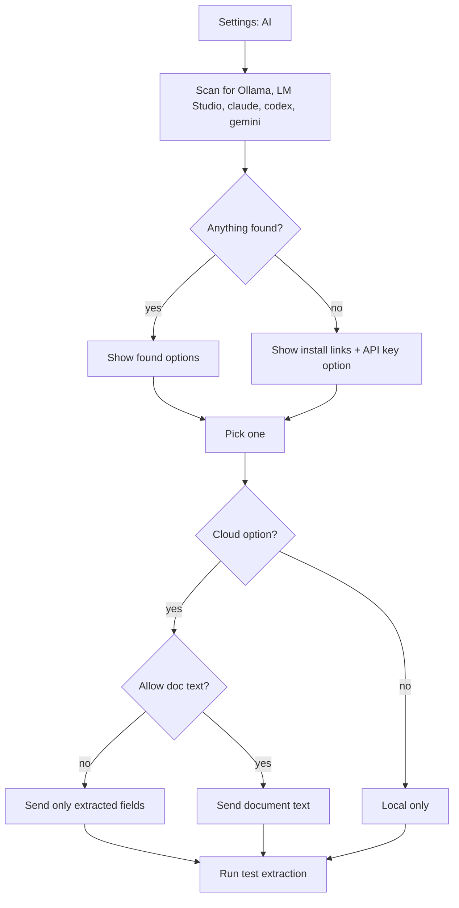

---

# B. Issue & sign

## F-11 Issue a SAFE from our template

**Steps**
1. Home → **+ New → SAFE**.
2. Investor name, email, amount, valuation cap, discount (optional), MFN (toggle), date. The live preview fills the YC post-money SAFE.
3. Impact line: "Fund Y ≈ 2.00% as-converted. SAFEs outstanding $900k → $1.1M."
4. **Send for signature.**
   - If there's no verified email, F-04 runs now.
   - The PDF is hashed locally, encrypted and uploaded to the relay.
   - The investor gets a link.
5. The investor signs in the browser, then the founder countersigns in the app.
6. The signed PDF is pulled back and its hash is checked against the original. Then a `safe_issued` event, the file goes to `docs/safes/`, and the relay deletes its copy.

**How signing actually works**
- The signing service is **Documenso**. By default it's an instance we host; the founder can point to their own (F-37).
- The app sends the PDF and the signer order (investor first, then founder) to it through the API.
- Documenso emails the investor a link. The investor opens it in any browser, types or draws a signature and submits. No account is needed.
- Then it's the founder's turn. They sign inside the app, which opens Documenso's signing page in an in-app window. No email round-trip.
- When everyone has signed, Documenso seals the PDF with a certificate and an audit log.
- The app downloads the sealed PDF, checks it against the original, files it, then calls the API to delete it from Documenso.
- **Be honest about what "encrypted" means:** the server has to read the PDF to show it to the signer. It's encrypted on the server's disk and in transit, and deleted after signing. It is not hidden from the server operator. If that matters to someone, they self-host.
- [Check which Documenso features (API, embedded signing) sit under its enterprise license before relying on them.]

**What can happen**

| Situation | Why | What happens |
|---|---|---|
| Investor wants changes | Negotiation | "Cancel" (F-17), edit the draft, send again |
| Investor sends their own paper instead | Institutional | "Investor sent their own paper" goes to F-12 |
| Offline | Travel | Saved as "Ready to send". Sends when back online |
| Signed PDF hash doesn't match | Tampered or corrupted | Not filed. Red alert: "Signed copy doesn't match what you sent" |
| Investor never signs | Busy | F-16 |

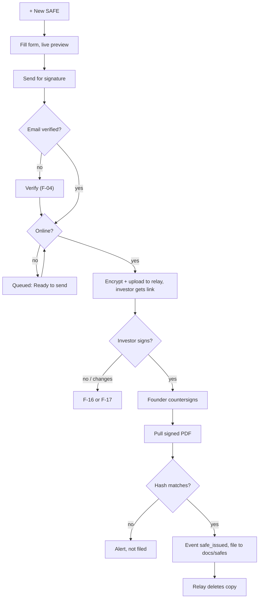

---

## F-12 Record a SAFE signed elsewhere

**Steps**
1. **+ New → SAFE → "Already signed"**, or drop the PDF (F-09).
2. Fields are extracted, then the founder confirms them.
3. A `safe_issued` event with `signed_outside: true`, linked to the PDF.

**What can happen**

| Situation | Why | What happens |
|---|---|---|
| Investor's own terms differ from the YC SAFE | Side letter, pro-rata, custom clauses | See "Terms that differ" below |
| Only one side signed | Never countersigned | Filed as partially signed and shown in What's missing |

**Terms that differ:**
- **If it's based on a YC SAFE:** the app compares the text with the matching YC template and highlights the changed clauses in the PDF viewer.
- **Side panel, "Terms that differ":** one plain line per difference, each linked to its page.
  - Examples: "Adds pro-rata rights (p.4)", "MFN clause added (p.5)", "Cap is $8M, not blank".
  - Each line is marked "AI summary, check the document".
- **If it's not template-based:** the panel lists the key terms found and any unusual clauses.
- **On confirm:** the founder ticks each line. It's saved as structured flags (`pro_rata`, `mfn`, `side_letter`) plus a note. Flags show as small tags on the cap-table row and are listed first in the lawyer export (F-30).

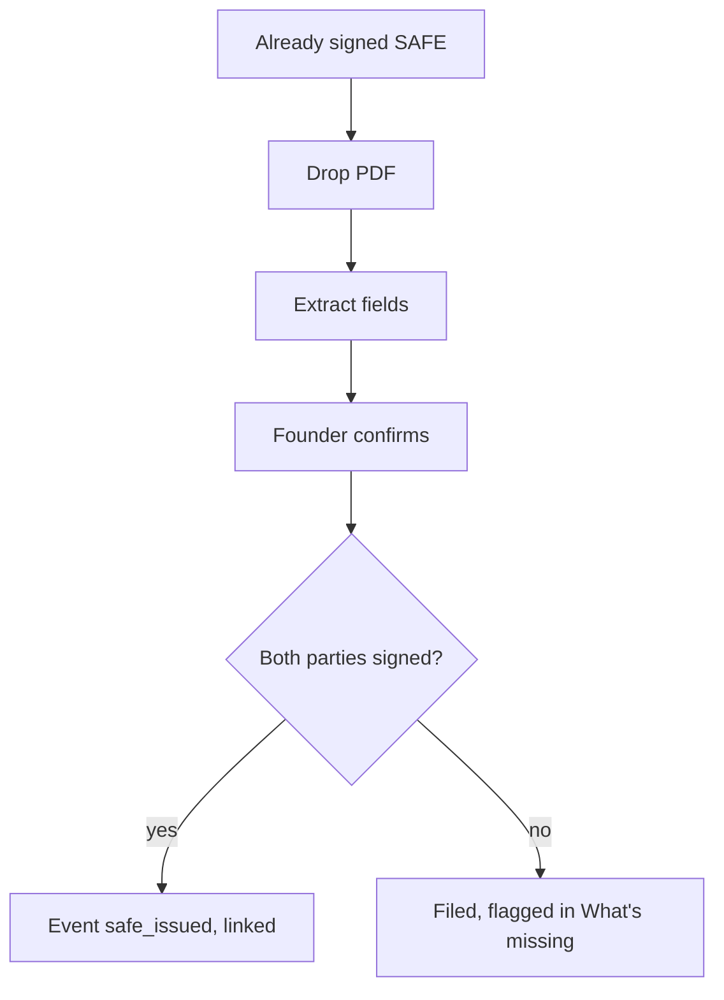

---

## F-13 Create the option pool and plan

**Steps**
1. **+ New → Option pool**: size (e.g. 1,000,000) and plan name.
2. The app generates or attaches the Equity Incentive Plan, the board consent and the stockholder consent.
3. These are sent for signature to the board members and stockholders the founder picks.
4. When signed: `pool_created`. Grants are possible from then on.

**What can happen**

| Situation | Why | What happens |
|---|---|---|
| Pool would exceed authorized | Not enough shares | Blocked, with a suggestion to increase authorized shares first (needs a charter amendment, flagged as lawyer work) |
| Plan already exists on paper | Lawyer did it | Attach the PDFs instead of generating |

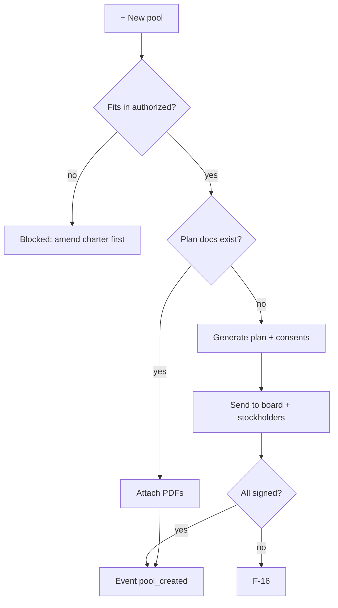

---

## F-14 Grant options

**Steps**
1. **+ New → Grant**: employee name, email, quantity, strike (the latest 409A, entered manually), vesting (4y / 1y cliff default), acceleration.
2. Pool check: "920,000 available → 880,000 after this grant".
3. Grants queue into **one board consent**, which is sent when the founder is ready.
4. After board approval, the grant notice goes to the employee.
5. The employee signs, then `option_granted`, filed in `docs/grants/`.

**What can happen**

| Situation | Why | What happens |
|---|---|---|
| Grant exceeds the pool | Typo, or pool too small | Blocked. "Increase pool (F-25)?" |
| No 409A, or it's older than 12 months | Early stage | Warning: "Strike may be challenged. Get a 409A." Not blocked |
| Board doesn't sign | Busy | F-16. The grant stays "Pending board" |
| Employee also needs an IP assignment | Missing | Offered together in one envelope |

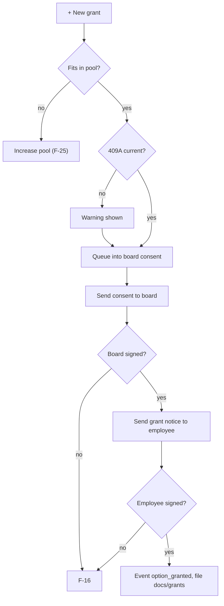

---

## F-15 Issue shares

Covers common stock to a founder or advisor, and preferred stock recorded after a priced round (the founder enters what the lawyer closed).

**Steps**
1. **+ New → Shares**: holder, class, quantity, price, date, certificate number (auto-generated).
2. Generate a stock purchase agreement, or attach one.
3. Sign, then `shares_issued`.
4. If common stock with vesting: an 83(b) reminder with the 30-day deadline.

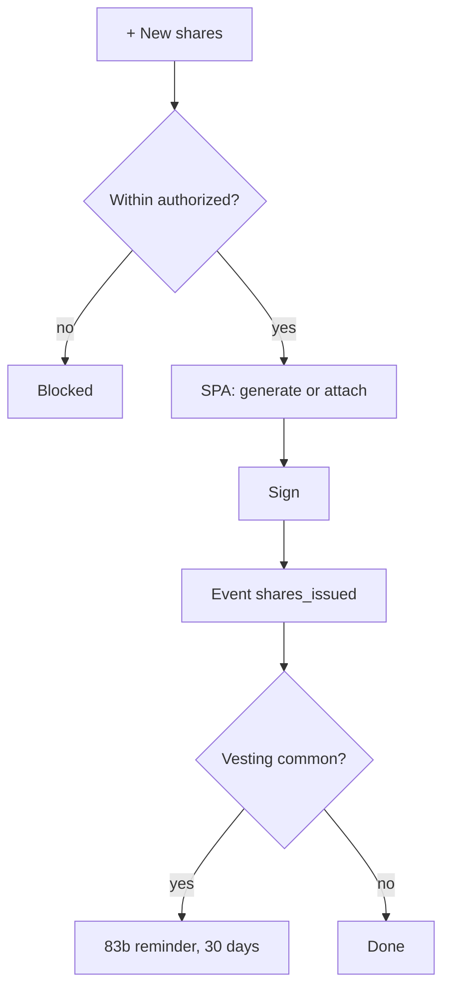

---

## F-16 A signer doesn't sign

**Steps**
1. Signatures shows "Sent 5 days ago · opened 0 times".
2. Automatic reminders on day 3 and day 7 (configurable), or **Send reminder** now.
3. The link expires after 30 days. The relay deletes the copy, and the app shows "Expired, resend?".

| Situation | Why | What happens |
|---|---|---|
| Wrong email | Typo | "Change signer email" cancels the old link and sends a new one |
| Signer says the link is broken | Corporate filter | Download the PDF. They sign elsewhere and the founder uploads it (F-12) |

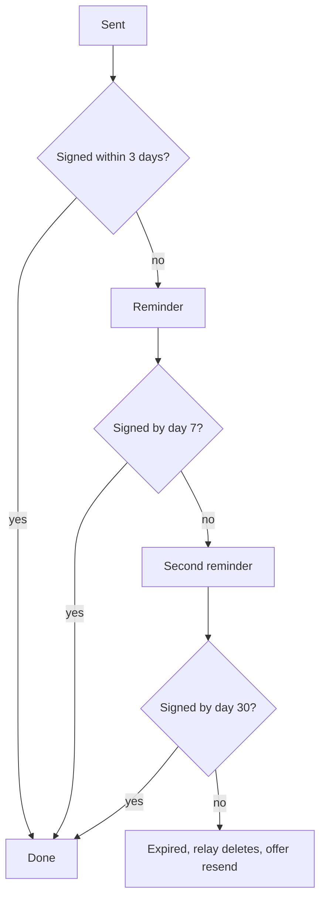

---

## F-17 Cancel a document before it's signed

**Steps:** Signatures → envelope → **Cancel & delete from relay**. The link dies, the relay copy is deleted, and a `doc_voided` event is written. The draft stays editable.

| Situation | What happens |
|---|---|
| One party already signed | Warning: "Steve already signed. Cancel anyway?" The partial PDF is kept in `docs/_voided/` |
| Already fully signed | Can't cancel. Use F-18 (fix) or F-24 (repurchase) |

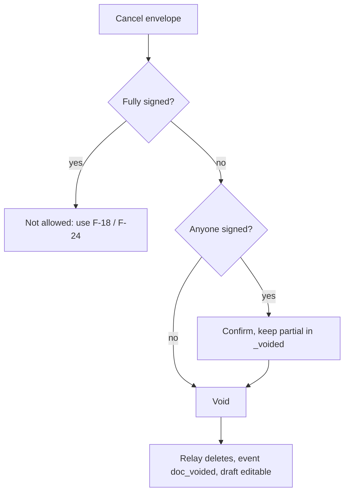

---

# C. Changes over time

## F-18 Fix a mistake

**Principle:** you can't edit history, only add a correction. That's what makes the record trustworthy.

| Mistake | Fix |
|---|---|
| Wrong number on a draft | Edit freely. Drafts aren't events |
| Wrong number on an issued item, but the signed document is correct | **Correct** writes a `correction` event pointing at the original, with the reason. The cap table updates and the history shows both |
| The signed document itself has the wrong number | A correction alone isn't enough. The app offers an amendment to sign. Until it's signed, the row shows "Correction pending signature" |
| Whole event entered by mistake (duplicate SAFE) | **Reverse** writes a `reversal` event and the row disappears. It stays visible in history |

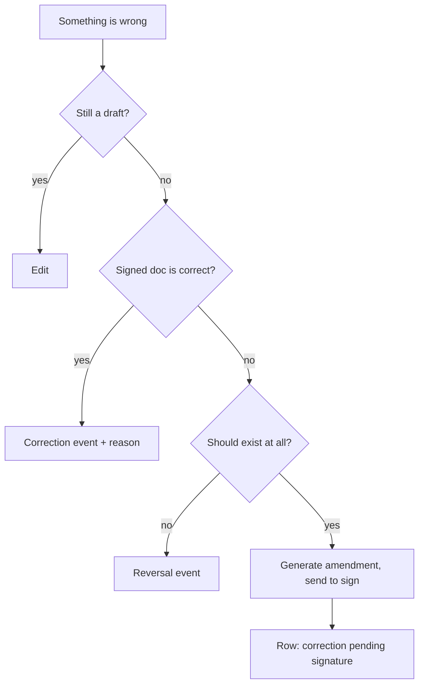

---

## F-19 Change a person's name or email

**Steps**
1. Person → **Edit**. The app asks: "Is this the same person or legal entity?"
2. If **same** (a name change, rebrand, new email): `stakeholder_updated`. Old names show as "formerly …". Signed documents are not rewritten, because they keep the name at signing.
3. If **different** (another legal entity): this is a transfer, not a rename, so go to F-20.

| Situation | Why | What happens |
|---|---|---|
| Email changed | Left job, new domain | Updated. Pending signature links are resent to the new email |
| Typo in a name | Import error | Same entity, so it's an update |

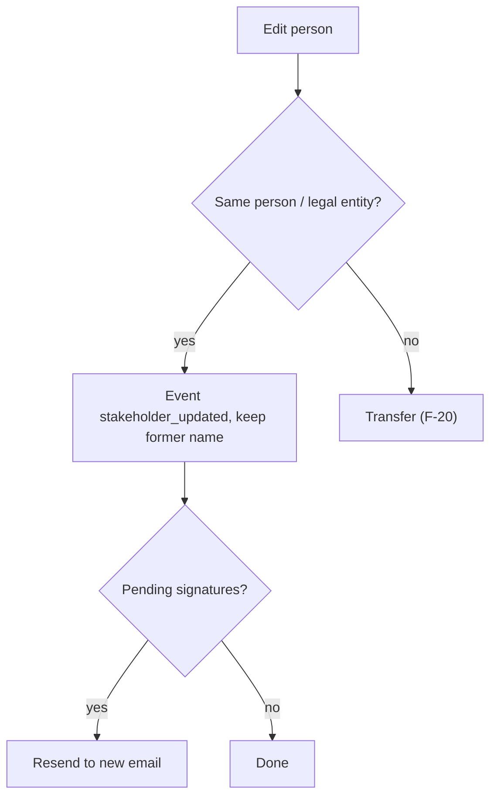

---

## F-20 An investor wants the SAFE moved to another entity

E.g. "please move our SAFE from Fund X LP to Fund X SPV I". SAFEs usually restrict transfer without company consent, so this needs paper.

**Steps**
1. On the investor's row → **Transfer…**
2. The new holder's details: name, entity type, email, and whether it's an affiliate of the current holder.
3. The app generates a transfer and assignment agreement plus the company consent. [Template from a lawyer; the app doesn't draft legal terms.] The founder can attach their own instead.
4. Signers: current holder, new holder, company.
5. When everything is signed:
   - a `safe_transferred` event closes the old row and opens the new one with the same terms and original date;
   - both documents link to it;
   - history shows the chain.

**What can happen**

| Situation | Why | What happens |
|---|---|---|
| It's only a rename | Same legal entity | The app routes to F-19 |
| Part of the SAFE moves | Split between entities | "Amount to transfer" splits into two rows. Totals are checked |
| Company says no | Founder's call | "Decline" logs a note. Nothing changes |
| Same request for shares | Share transfer | Same flow, with a reminder to check bylaws, right of first refusal and board approval |

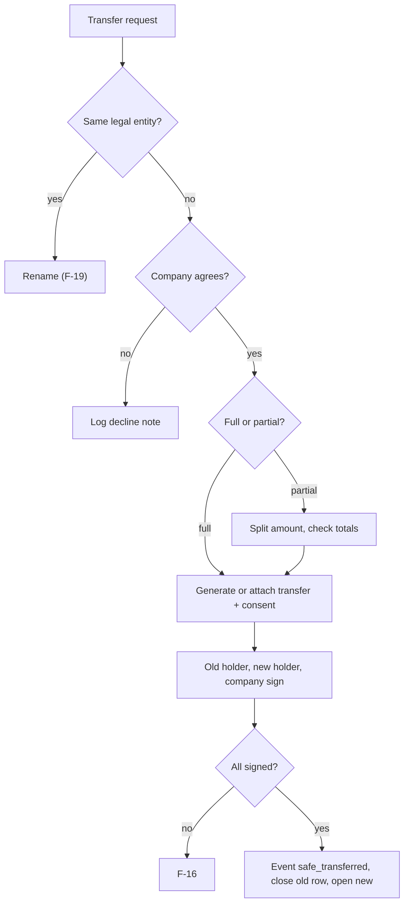

---

## F-21 Merge duplicate people

**Steps:** People → select two → **Merge**. Pick which name and email to keep. `stakeholder_merged` moves all holdings and documents to one person, and the other becomes an alias used for future document matching.

| Situation | What happens |
|---|---|
| They're actually different entities | Merge blocked if both hold the same instrument dated the same day with different signers. "Are you sure? These look like separate investors" |

```mermaid
flowchart TD
  A["Select two people"] --> B{"Looks like different entities?"}
  B -- yes --> C["Warn, ask to confirm"]
  B -- no --> D["Pick name + email to keep"]
  C --> D
  D --> E["Event stakeholder_merged, alias kept"]
```

---

## F-22 An employee leaves

**Steps**
1. Person → **Terminate…** → last day, reason (voluntary / for cause / other).
2. The app calculates:
   - vested as of the last day, e.g. 12,500;
   - unvested returned to the pool, e.g. 27,500;
   - exercise deadline (plan default, e.g. 90 days).
3. Preview, then `termination` event. The pool increases. The exercise deadline shows on the home screen.
4. Optional: generate a termination notice for the employee.

| Situation | Why | What happens |
|---|---|---|
| Before the cliff | Left early | Vested 0, all of it returns to the pool |
| Acceleration applies | Change of control, double trigger | Asks which trigger occurred and applies the plan terms |
| Deadline passes without exercise | Common | Vested options expire back to the pool. An event and a notice are shown |

```mermaid
flowchart TD
  A["Terminate"] --> B["Last day + reason"]
  B --> C{"Before cliff?"}
  C -- yes --> D["All unvested to pool"]
  C -- no --> E["Compute vested / unvested"]
  E --> F{"Acceleration triggered?"}
  F -- yes --> G["Apply plan terms"]
  F -- no --> H["Unvested to pool"]
  G --> H
  D --> I["Event termination"]
  H --> I
  I --> J["Exercise deadline on home"]
  J --> K{"Exercised before deadline?"}
  K -- yes --> L["F-23"]
  K -- no --> M["Vested expire to pool"]
```

---

## F-23 An employee exercises options

**Steps:** Person → **Record exercise** → quantity (≤ vested and unexercised), date, payment received (yes/no). Generate or attach the exercise notice, then sign. `exercise` converts the options to common shares. Optional 83(b) prompt for early exercise.

```mermaid
flowchart TD
  A["Record exercise"] --> B{"Quantity within vested?"}
  B -- no --> C["Blocked"]
  B -- yes --> D["Exercise notice, sign"]
  D --> E{"Payment received?"}
  E -- no --> F["Pending payment"]
  E -- yes --> G["Event exercise: options to common"]
```

---

## F-24 A founder leaves (repurchase unvested)

**Steps:** Person → **Repurchase unvested…** → date. The app computes the unvested shares and the repurchase price (the original price paid). Generate a repurchase notice, then sign. `repurchase` returns the shares to treasury and the cap table updates.

| Situation | What happens |
|---|---|
| Founder had no vesting | Nothing to repurchase. Any buyback is a negotiated transfer (F-20 pattern) |
| Repurchase window is defined in the SPA | Shows the deadline from the agreement date [founder enters it] |

```mermaid
flowchart TD
  A["Founder leaves"] --> B{"Has unvested shares?"}
  B -- no --> C["Negotiated transfer (F-20)"]
  B -- yes --> D["Compute unvested + price"]
  D --> E["Repurchase notice, sign"]
  E --> F["Event repurchase, to treasury"]
```

---

## F-25 Increase the option pool

Same as F-13, with a board and stockholder consent for the increase. Blocked if it would exceed authorized shares.

```mermaid
flowchart TD
  A["Increase pool"] --> B{"Within authorized?"}
  B -- no --> C["Amend charter first (lawyer)"]
  B -- yes --> D["Consents, sign"]
  D --> E["Event pool_increased"]
```

---

# D. Documents

## F-26 Add a document

Drop it anywhere in the app → F-09 pipeline → linked to a row, or kept as a general company document (bylaws, certificate).

```mermaid
flowchart TD
  A["Drop file"] --> B["F-09 pipeline"]
  B --> C{"Linked to a row?"}
  C -- yes --> D["Row shows doc"]
  C -- no --> E["Company docs"]
```

## F-27 Delete a document

**Steps:** Documents → file → **Remove**.
- If it's the only proof for a holding: "This is the only signed document for Fund X's SAFE. Removing it will show a gap." The founder confirms.
- The file moves to `docs/_removed/` and a `doc_removed` event is written. The row now shows the gap.
- The app never deletes the file permanently. The founder can empty `_removed/` in Finder if they really want to.

| Situation | What happens |
|---|---|
| Wrong file was linked | Use "Unlink" instead. The file stays and the link is removed |
| Duplicate | "Remove duplicate". The other copy stays linked |

```mermaid
flowchart TD
  A["Remove doc"] --> B{"Only proof for a holding?"}
  B -- yes --> C["Warn: gap will show"]
  C --> D{"Confirm?"}
  D -- no --> E["Cancel"]
  D -- yes --> F["Move to _removed, event doc_removed"]
  B -- no --> F
  F --> G["Row shows gap if any"]
```

## F-28 Replace or rename a document

- **Replace** (better scan, final version): drop the new file on the old one. The hashes are compared.
  - If it's the same document but a better scan: it replaces the old one, which moves to `_removed/`.
  - If the content differs: "This looks like a different document. Replace anyway?"
- **Rename:** only the display name changes. The file name follows the convention `<date>_<person>_<type>.pdf`.

```mermaid
flowchart TD
  A["Drop new file on doc"] --> B{"Same content?"}
  B -- yes --> C["Replace, old to _removed"]
  B -- no --> D{"Replace anyway?"}
  D -- yes --> C
  D -- no --> E["Add as separate doc"]
```

---

# E. Share

## F-29 Export Excel / CSV for a date

**Steps:** Home → **Export** → as-of date (default today) → format: `.xlsx` (Summary, By person, Vesting, SAFEs tabs) or `.csv` (Pulley/Carta-style columns). The file is saved where the founder picks.

| Situation | What happens |
|---|---|
| Date before the company existed | Blocked |
| Pending signatures on that date | Included, marked "pending" |

```mermaid
flowchart TD
  A["Export"] --> B["Pick date"]
  B --> C["Replay events up to date"]
  C --> D{"Format"}
  D -- xlsx --> E["4 tabs"]
  D -- csv --> F["Standard columns"]
```

## F-30 Send everything to a lawyer

**Steps:** Documents → **Share with lawyer** → choose what to include (everything / one round / one person). The app builds a `.zip` with the cap table PDF + xlsx, every linked signed PDF, `events.jsonl`, `README.txt` and the What's missing list. The founder sends it however they like. v1 doesn't upload anything.

```mermaid
flowchart TD
  A["Share with lawyer"] --> B["Choose scope"]
  B --> C["Build zip"]
  C --> D["Founder sends it (email, Drive)"]
```

---

# F. Safety

## F-31 Verify the vault / a file was edited outside the app

The app runs a check on every open and has a **Verify** button.

| Situation | Why | What happens |
|---|---|---|
| All good | — | "Vault verified · 214 events · 100.00%" |
| `captable.csv` edited by hand | Someone used Excel | Rebuilt from events. The edited copy is saved as `captable.edited.csv`: "Your edits weren't applied. Make changes in the app." |
| `events.jsonl` line changed | Manual edit or corruption | The hash chain breaks at line N. Red banner. Options: restore from backup (F-32), or accept as the new starting point (writes a signed `rebaseline` event with a reason) |
| A linked PDF is missing | Moved or deleted in Finder | Row shows "Document missing", with an option to locate it |

```mermaid
flowchart TD
  A["Open / Verify"] --> B{"Hash chain intact?"}
  B -- no --> C["Red banner at line N"]
  C --> D{"Restore or rebaseline?"}
  D -- restore --> E["F-32"]
  D -- rebaseline --> F["Event rebaseline + reason"]
  B -- yes --> G{"captable.csv matches?"}
  G -- no --> H["Regenerate, keep edited copy"]
  G -- yes --> I{"All linked docs present?"}
  I -- no --> J["Flag missing, offer locate"]
  I -- yes --> K["Verified"]
```

## F-32 Move to a new laptop

**Steps:** Install the app → **Open existing folder** → pick the synced folder (iCloud, Dropbox) or a copied one. Verify (F-31), set up app lock again (F-03), and confirm the relay email again if signing is used.

```mermaid
flowchart TD
  A["Install on new laptop"] --> B["Open existing folder"]
  B --> C["Verify (F-31)"]
  C --> D["Set app lock (F-03)"]
  D --> E["Home"]
```

## F-33 Laptop lost or broken

- **If the folder was backed up:** F-32. Nothing is lost.
- **If it wasn't:** the data on that laptop is gone. That's why F-05 nags until a backup exists.
- Pending envelopes on the relay keep running. Signed copies wait on the relay (up to 30 days) until the new laptop pulls them.

```mermaid
flowchart TD
  A["Laptop gone"] --> B{"Folder backed up?"}
  B -- yes --> C["New laptop (F-32)"]
  B -- no --> D["Data lost, rebuild from docs (F-09)"]
  C --> E["Pull pending signed docs from relay"]
```

## F-34 Touch ID fails / forgot the app password

- **Touch ID / Hello** falls back to the computer's own password.
- **App password forgotten:** "Reset app lock" asks for the computer's admin password and removes the lock. The data is never affected, because the files aren't encrypted.

```mermaid
flowchart TD
  A["Can't unlock"] --> B{"Method"}
  B -- biometric --> C["Fall back to OS password"]
  B -- "app password" --> D["Reset with OS admin password"]
  C --> E["Open"]
  D --> F["Set new lock"]
  F --> E
```

## F-35 Two copies of the folder disagree

Rare with one admin, but it happens: the app is open on two laptops, both offline, and both add events.

**What happens:** on open, the app sees two branches after event N.
- If the branches don't conflict (different people, different instruments), it shows both lists. "Merge" appends the second branch after the first and re-runs the checks.
- If they conflict (the same grant edited on both): the founder picks one per item.

```mermaid
flowchart TD
  A["Open"] --> B{"Event log forked?"}
  B -- no --> C["Normal"]
  B -- yes --> D["Show both branches"]
  D --> E{"Conflicting items?"}
  E -- no --> F["Merge, re-run checks"]
  E -- yes --> G["Founder picks per item"] --> F
```

## F-36 The relay is down or I'm offline

Everything except sending and pulling signatures keeps working. Outgoing envelopes queue ("Ready to send"), signed copies are pulled when the connection returns, and the status shows on Signatures.

```mermaid
flowchart TD
  A["Send / pull"] --> B{"Relay reachable?"}
  B -- yes --> C["Proceed"]
  B -- no --> D["Queue, retry with backoff"]
  D --> B
```

## F-37 Switch to a self-hosted relay

**Steps:** Settings → Signing → **Use my own relay** → URL → test connection → save. New envelopes use the new relay. Envelopes already open finish on the old one, and the app keeps polling both until they're done.

```mermaid
flowchart TD
  A["Enter relay URL"] --> B{"Test OK?"}
  B -- no --> A
  B -- yes --> C["New envelopes use it"]
  C --> D["Old envelopes finish on old relay"]
```

## F-38 Update the app

Two kinds of update, so we can fix things after install without waiting for a full release:

| What | How | How often |
|---|---|---|
| **The app itself** | Tauri updater. Signed bundles plus a `latest.json` on GitHub Releases. The app checks on open: "Version 0.3 is ready. What changed: …" → **Update** → relaunch | Releases |
| **Rules pack** | A signed JSON bundle the app downloads in the background. Contains export instructions per tool (F-07), column mappings, document-type rules (F-09), checks, and template versions | Any time, no reinstall |

- Both are signed. The app rejects anything that doesn't match our public key. [Keep the signing key safe: losing it means existing installs can't be updated.]
- Event-format changes migrate by appending `schema_migrated`, never by rewriting old lines.
- Settings → Updates: auto, ask, or off. Off still works forever, because the folder is plain files.

```mermaid
flowchart TD
  A["App opens"] --> B["Check latest.json + rules pack"]
  B --> C{"Signature valid?"}
  C -- no --> D["Ignore, log warning"]
  C -- yes --> E{"App update?"}
  E -- yes --> F["Show changes, Update, relaunch"]
  E -- no --> G{"Rules pack newer?"}
  G -- yes --> H["Swap rules pack, no restart"]
  G -- no --> I["Continue"]
  F --> J{"Format change?"}
  J -- yes --> K["Append schema_migrated"]
  J -- no --> I
  K --> I
  H --> I
```

---

## Not in v1

- Encrypting the vault (planned opt-in)
- Multiple admins / real-time sync
- Investor or employee app login to see their own holdings
- Round modeling, waterfalls, 409A
- Non-US entity templates (track only)
- Converting SAFEs at a priced round (the founder records the result the lawyer gives them via F-15)

## Decided

- Templates: use YC's SAFEs unmodified and credited. For transfer, repurchase, termination and other documents: **attach your own**. No lawyer-drafted templates in v1.
- Vendor terms for driving Claude Code / Codex / Gemini CLIs: not a blocker for v1.
- Email gate on the website stays required. Track the submit rate.

## Open questions

1. Real Pulley export files from the pilot company. They're needed before Dec 8.
2. Which Documenso features are under its enterprise license, and does that matter for a hosted relay?
3. Is Captable, Inc. still maintained enough to port the vesting logic from?
