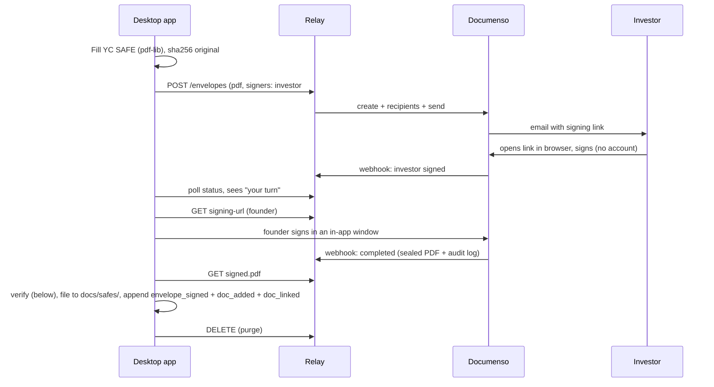

# 05 · Signing (F-11, F-16, F-17, F-36, F-37)

## Roles
- **Desktop app:** prepares the PDF, starts envelopes, polls status, fetches the signed PDF, verifies it, files it, and asks the relay to delete.
- **Relay (`apps/relay`):** a thin API we run (or the user self-hosts). It holds the Documenso admin token and is the only thing that talks to Documenso.
- **Documenso (self-hosted):** the signing UI, emails, sealing (certificate + audit log). AGPL. [Verify which needed features, such as API and embedded signing, are under its enterprise license.]

## Relay API (ours) [design; adjust names freely]
| Method | Path | Purpose |
|---|---|---|
| POST | `/auth/start` | `{email}` → emails a 6-digit code |
| POST | `/auth/verify` | `{email, code}` → returns a device token (long-lived, revocable) |
| POST | `/envelopes` | multipart: PDF + `{title, signers:[{name,email,order}], fields?, external_id}` → `{envelope_id, status}` |
| GET | `/envelopes/:id` | status per signer: `sent / opened / signed`, timestamps |
| GET | `/envelopes/:id/signed.pdf` | sealed PDF (available when all have signed) |
| GET | `/envelopes/:id/signing-url?signer=` | URL for the founder's own signature, opened in an in-app window |
| POST | `/envelopes/:id/remind` | resend to unsigned signers |
| DELETE | `/envelopes/:id` | void (if unsigned) or purge (after the app confirms it filed the PDF) |

**Relay internals:**
- Maps to the Documenso v2 API: create document/envelope, add recipients with signing order, distribute/send, get status, download, delete. [Verify endpoint names in the Documenso docs.]
- Receives Documenso webhooks (document signed/completed) and stores only `{envelope_id, status, timestamps}`.
- **Cron:** remind on day 3 and day 7; purge anything older than 30 days; purge 24h after the app fetched the signed PDF.

## Flow

## Verify the signed PDF before filing
The sealed PDF is not byte-identical to the original, so a plain hash compare fails. Instead:
1. Extract the text of the signed PDF's original pages (PDF.js) and compare it with the original's text. All terms must be equal.
2. Check that the Documenso signature/certificate is present and valid [verify how Documenso exposes this].
3. Check that the signer names and emails in the audit log match the envelope.

If any check fails: don't file. Red alert: "Signed copy doesn't match what you sent."

## Honesty in copy
The relay and Documenso must read the PDF to show it to the signer. Say "encrypted in transit and on disk, deleted after signing", **not** "the server can't see it". If someone needs zero third-party access, they self-host (F-37).

## Self-hosting
`apps/relay/docker-compose.yml` runs relay + Documenso + Postgres + SMTP settings. In the app: Settings → Signing → "Use my own relay" → URL → test.
